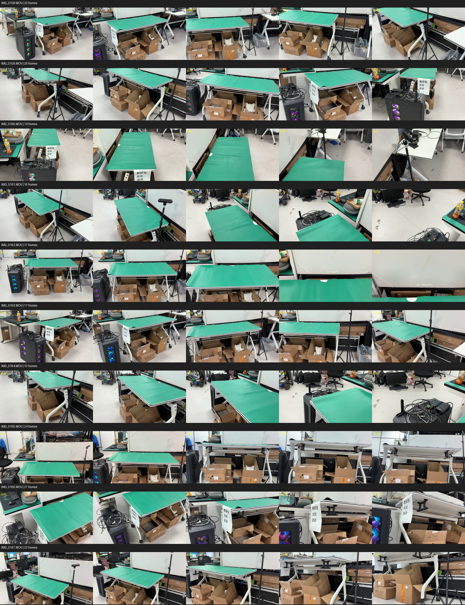

# 原工作台场景重建

本项目以原来拍摄的 `workcell-v4` 工作台为目标，使用 Artisan 逐个建模场景里的物体，再在 MuJoCo 中组装完整场景。旧工程只提供已经复制进本目录的参考照片、相机位姿和对齐记录，不参与新场景运行。



Artisan 的基本单位是一个物体：编写该物体的 `model.py`，由它导出 URDF 和网格，并检查物理属性、关节和几何。它不是从全景照片直接生成完整房间的场景重建器。因此我们会把照片里可见的环境拆成桌面、桌架、纸箱、电脑塔、周边桌柜、白板和小设备等资产，再按场景清单放回相对位置。重复物体生成一个模型后多次实例化。

## 现有资料

- `references/workcell-v4/images/`：202 张原始去畸变参考图，按拍摄视频分组。
- `references/workcell-v4/frame-contact-sheet.jpg`：全场景视图索引。
- `references/workcell-v4/metadata/cameras.npz` 与 `camera-names.json`：每张图对应的相机位姿及名称。
- `references/workcell-v4/metadata/table-alignment-visual-accepted.json`：已接受的多视角视觉对齐快照；文件内已注明米制标定仍未验证。
- `references/workcell-v4/metadata/robot-placement-source.json`：旧场景中 NERO 双臂底座的近似安装位置及验证范围。
- `references/workcell-v4/metadata/source-scene-config.json`：旧场景状态快照，只作资料，不是新项目配置。

这些照片用于观察外形、相对位置和遮挡。尺寸以已明确的测量为准；照片推断出的尺寸需要进一步确认。旧场景中的 Gaussian 表示和 Isaac USD 没有复制过来，也不会成为新场景的运行依赖。

## 当前场景基准

- 坐标原点 A 位于主工作台靠 PC/前侧的角；+X 沿 1.2 m 长边，+Y 朝白板，+Z 向上。
- 主工作台整体标称尺寸为 `1.20 × 0.60 × 0.75 m`。这些数值来自用户确认；桌板厚度 `0.03 m` 只是旧预览使用的假设，未测量。
- 旧场景接受过 NERO 安装位置的近似视觉摆放：底座相对 A 约为 `(0.25, -0.10, -0.17) m`，偏航角约 `90°`。机械臂的实物坐标、朝向、支架尺寸及标定都还没有物理验证。
- NERO 支架在旧场景中只是盒体占位，约 `0.58 m` 高，尚无实测外形或尺寸；清单中保留为单独静态物件，避免把占位盒误当成已还原模型。
- 场景中 NERO 保留专用机器人模型，Artisan 不重新猜测它的关节结构。第一阶段先还原静态工作台和周边物件，再接入机器人模型和交互任务。

机器可读的资产清单见 `asset_register.yaml`，统一布局约束见 `scene_spec.json`。证据状态分为 `measured_or_user_confirmed`、`visual_estimate`、`unknown`，不要把近似视觉摆放写成精确标定结果。

## 重建顺序

1. 按照片确认对象清单、实例数量和前后关系；无法确认的物体先标成待辨认。
2. 用 Artisan 建立关键物体资产，优先工作台、桌架、电脑塔和白板/周边桌柜；打开、抽拉等运动结构单独标注关节。
3. 对 URDF、网格、质量、关节范围和碰撞做逐件检查。完整 Artisan 迭代记录保存在 `runs/`；确认可用的最终资产再整理到 `assets/generated/`。
4. 将资产装配到 MuJoCo 主场景。MuJoCo 3.9 可用 `MjSpec.from_file()` 读取 URDF，再通过 `MjSpec.attach()` 挂到场景中的坐标框架；因此 Artisan 导出的 URDF 能与固定环境和 NERO 模型一起组成一个 MJCF 场景。固定背景和简单平面直接在 MJCF 中参数化。参见 [MuJoCo model editing](https://mujoco.readthedocs.io/en/stable/programming/modeledit.html) 和 [Python attachment API](https://mujoco.readthedocs.io/en/latest/python.html#attachment)。
5. 用原相机视角渲染并与照片比较，先校正比例和摆放，再验证 NERO 的桌边安装、工作空间、碰撞和接触行为。

目录中的 MJCF 场景和 Artisan 生成资产目前尚未创建，重建项目仍处于素材和规格梳理阶段。

## 首个 Artisan 调用示例

安装官方 Artisan 环境并配置模型凭据后，从仓库根目录运行。官方默认单个资产最高预算是 15 美元；下面的命令将明确限制为 5 美元：

```bash
./run.sh run \
  "Reconstruct only the primary workbench visible in the reference images as one physically plausible static multi-part asset. The rectangular green work surface is 1.20 m long and 0.60 m deep, and its top is 0.75 m above the floor. Add the visible pale metal perimeter, curved pale metal legs, under-frame, adjustment rail and casters. Treat all supports as fixed because their adjustment mechanism and travel are not measured. Use a provisional 0.03 m top thickness. Preserve the green surface, white frame, real gaps between frame members, and a stable mass distribution. Do not add boxes, computers, people, a robot, or a room." \
  --image reconstruction/references/workcell-v4/images/IMG_0166/frame-000150.png \
  --image reconstruction/references/workcell-v4/images/IMG_0165/frame-000145.png \
  --image reconstruction/references/workcell-v4/images/IMG_0161/frame-000165.png \
  --max-cost-usd 5
```

示例从最重要的桌体开始验证单物体建模链路；预算并不代表模型一定能严格恢复隐藏面或真实尺寸。正式生成时还要给桌架补充无遮挡的侧视图，并依据几张视角图检查结构。资产按桌面 A 点为原点、+X 沿长边、+Y 朝白板、+Z 向上，方便放回全场景。
